# Puma Launcher

A modern, open-source Minecraft: Java Edition launcher for Windows, macOS and Linux. It installs any Minecraft
version, with or without Fabric, Quilt, Forge or NeoForge, downloads the right Java for you, installs mods from
Modrinth, and has a wardrobe and 3D editor for your skins. Available in English and Italian.

<sub>NOT AN OFFICIAL MINECRAFT PRODUCT. NOT APPROVED BY OR ASSOCIATED WITH MOJANG OR MICROSOFT.</sub>

<p align="center">
  <a href="https://github.com/txtaan/Puma-Launcher-Minecraft/releases/latest">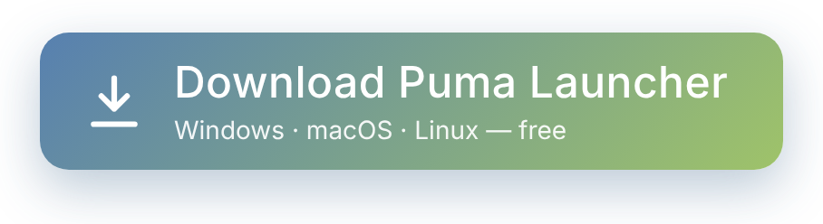</a>
</p>

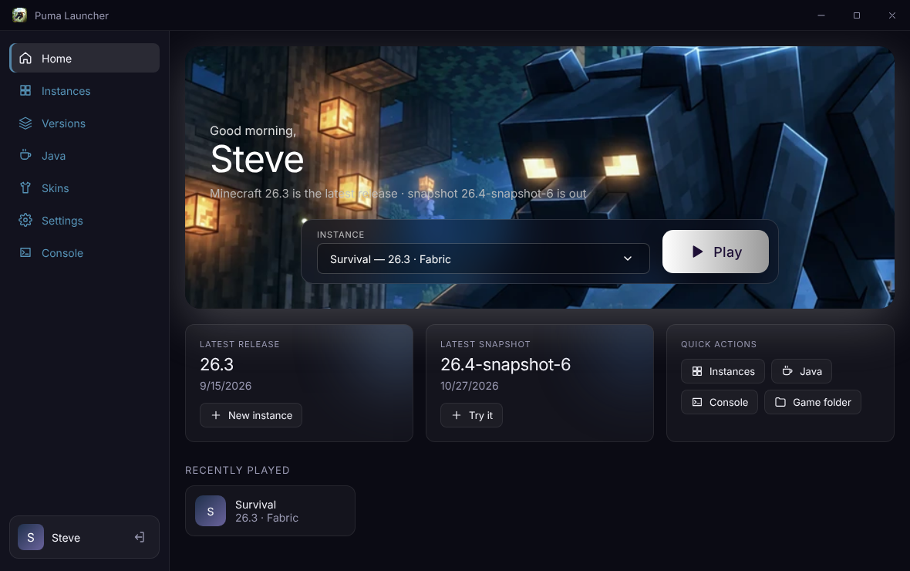

## Step by step: from download to playing

### 1. Download

<p align="center">
  <a href="https://github.com/txtaan/Puma-Launcher-Minecraft/releases/latest"></a>
</p>

The button opens the latest release: scroll down to **Assets** and pick the file for your computer.

| Your computer | File to download |
| --- | --- |
| Windows 10 or 11 | `PumaLauncher-<version>-windows-x64-setup.exe` |
| Mac with an Apple chip (M1 or newer) | `PumaLauncher-<version>-macos-arm64.dmg` |
| Mac with an Intel chip | `PumaLauncher-<version>-macos-x64.dmg` |
| Linux | `PumaLauncher-<version>-linux-x86_64.AppImage` (any distribution) or `PumaLauncher-<version>-linux-amd64.deb` (Debian, Ubuntu) |

Not sure which Mac you have? Open the Apple menu → **About This Mac**: "Chip: Apple M…" means an Apple chip,
"Processor: … Intel" means Intel. You don't need to install Java or Minecraft separately: the launcher downloads both.

### 2. Install

- **Windows:** run the `.exe` and follow the installer. If SmartScreen says "Windows protected your PC", click
  **More info → Run anyway** (the launcher isn't code-signed yet).
- **macOS:** open the `.dmg` and drag **Puma Launcher** into **Applications**. If macOS says it can't verify the app
  the first time you open it, go to **System Settings → Privacy & Security** and click **Open Anyway**.
- **Linux:** make the AppImage executable with `chmod +x PumaLauncher-*.AppImage` and run it, or install the `.deb`
  with `sudo apt install ./PumaLauncher-*.deb`.

### 3. Sign in

Open Puma Launcher, click **Play Now** and type a player name (3–16 letters, numbers or underscores) to play
offline right away. You can also use a **Microsoft** account (it needs a one-time setup, see
[Microsoft login setup](#microsoft-login-setup)) or an **Ely.by** / **LittleSkin** account.

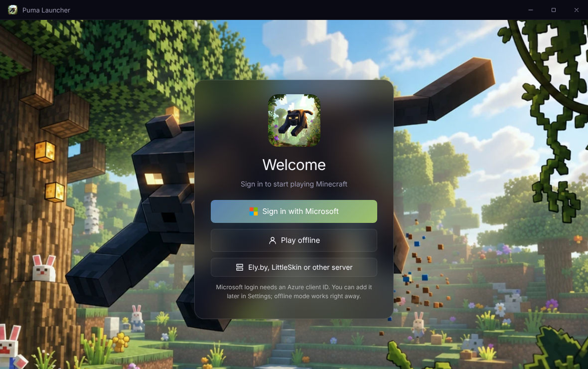

### 4. Create an instance

An instance is one Minecraft installation with its own worlds and mods. On the home screen click **Create**. The
latest Minecraft version is already selected: give it a name, pick a mod loader such as **Fabric** if you want
mods, and click **Create**. The right Java version starts downloading by itself.

With a mod loader picked, the dialog also suggests popular mods that have a build for that exact version and loader
(Fabric API, Sodium, Lithium, FerriteCore, Iris, JEI and more). The essentials and performance mods start ticked;
untick or tick any of them, and they're installed with their dependencies as soon as the instance is created.

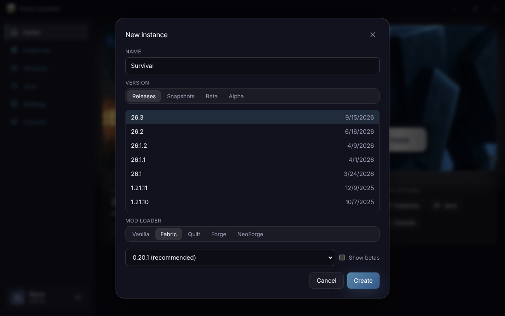

### 5. Press Play

Choose your instance on the home screen and press **Play**. The first launch downloads the game, which takes a few
minutes; the progress shows in the bottom-right corner. After that the game starts in seconds.

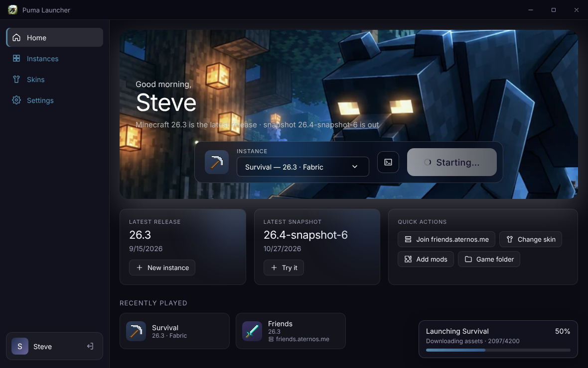

### 6. Add mods (optional)

Go to **Instances**, click the puzzle-piece icon on your instance, open **Browse Modrinth** and click **Install**.
Required mods are installed with it. Mods need an instance with a mod loader (Fabric, Quilt, Forge or NeoForge).

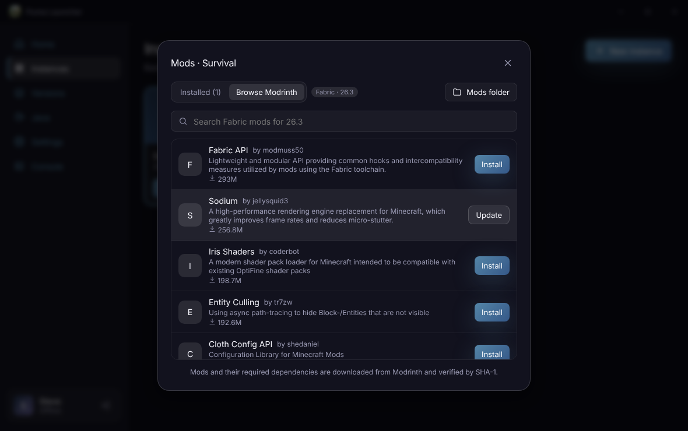

### 7. Wear a skin (optional)

Open **Skins**. Pick a skin in the **Wardrobe** and press **+** to wear it, or make your own: start from a template
under **Create** and paint it on the 3D model. You can also drop PNG skins onto the page, pick them with **From file**,
or copy the skin any Java Edition player wears by typing their name.

- **Microsoft accounts:** the skin is uploaded to your Minecraft profile, so everyone sees it, on any server.
- **Offline accounts:** when you press **Play**, Puma puts the skin in a resource pack (`PumaSkin`) and turns it on,
  so you see it in game (Minecraft 1.8 and newer). Other players don't: a server can't receive a skin from an offline
  account. Because the pack replaces the default skins, other players who use a default skin also look like you on
  your screen. Take the skin off and the pack is removed at the next launch.
- **Ely.by, LittleSkin and other servers** give your account its skin: export the PNG and upload it on their website.

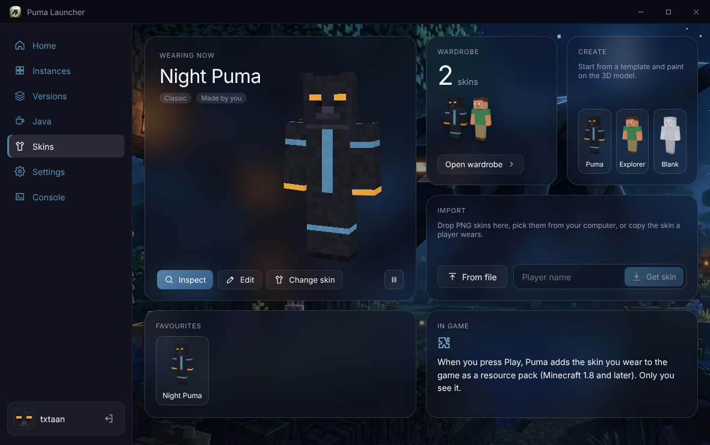

You can switch between the light and dark theme, and between English and Italian, in **Settings → Appearance**.

### Updating

From version 0.3.3 the launcher updates itself; there's no need to come back here. It checks for a new version when it
starts and every few hours, downloads it in the background, and shows an **Update to …** button in the sidebar
when it's ready (also in **Settings → Updates**, with a **Check for updates** button):

- **Windows** and the Linux **AppImage**: the button restarts the launcher into the new version.
- **macOS** and the Linux **.deb**: the button opens the downloaded installer. On a Mac, drag Puma Launcher into
  Applications to replace the old version.

Versions before 0.3.3 can't update themselves: download the latest installer once with the button above.

## Screenshots

| Light theme | In Italian | Java |
| --- | --- | --- |
| 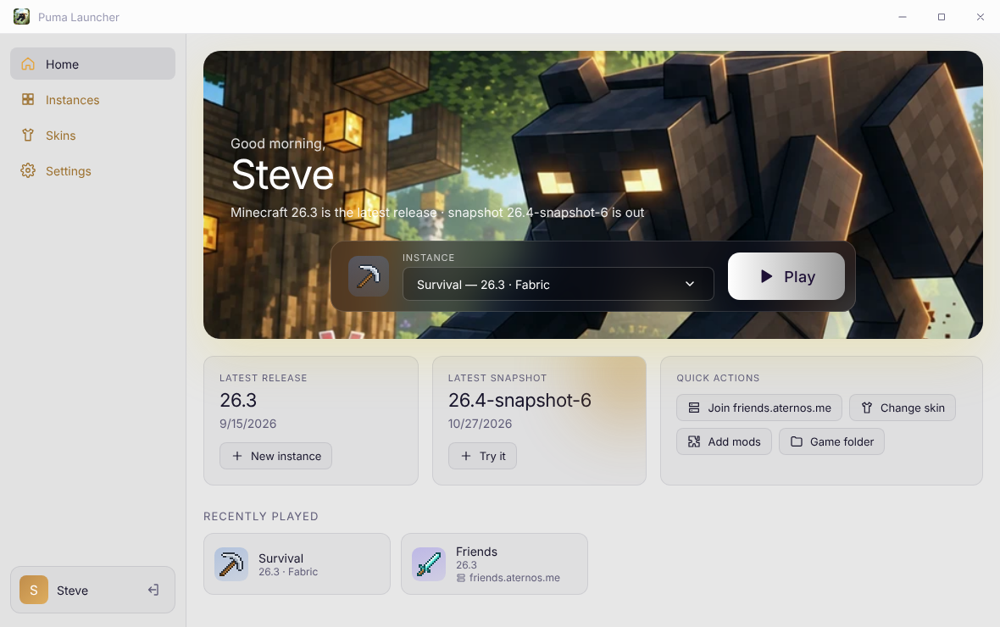 | 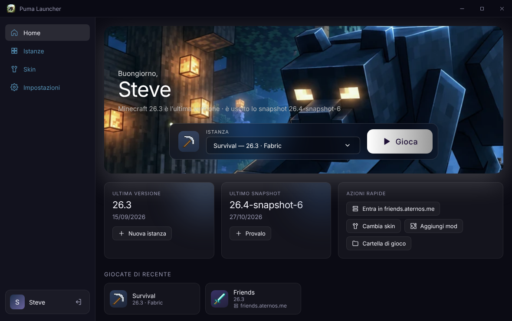 | 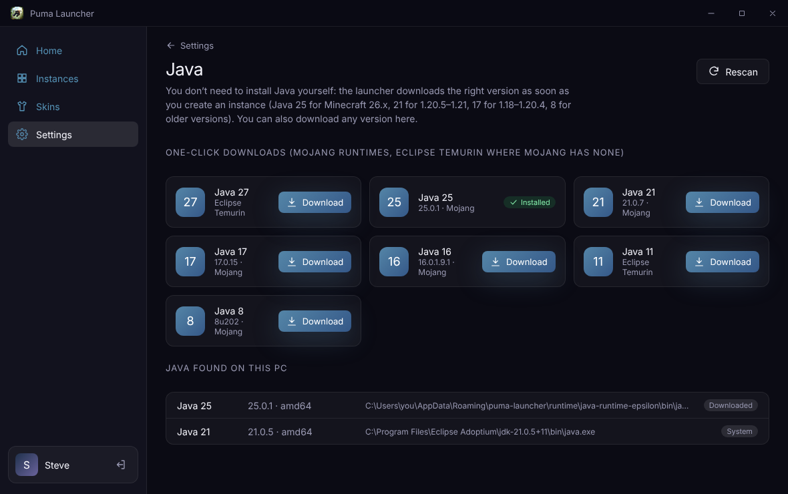 |

| Wardrobe | Inspect a skin | Skin editor |
| --- | --- | --- |
| 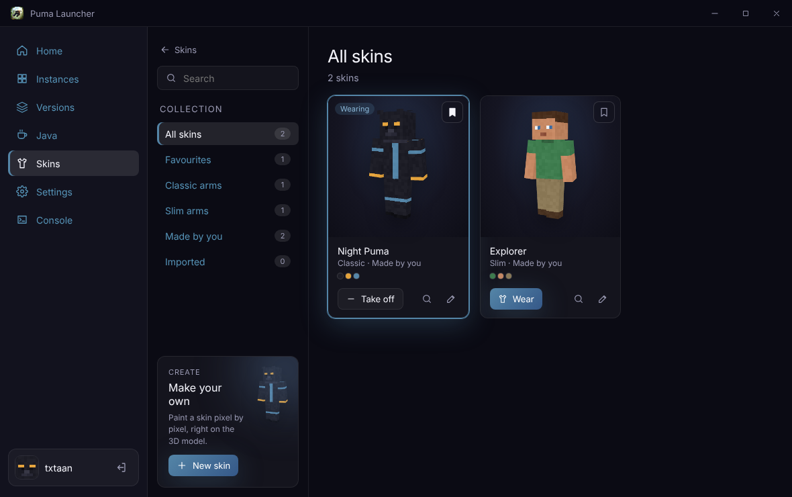 | 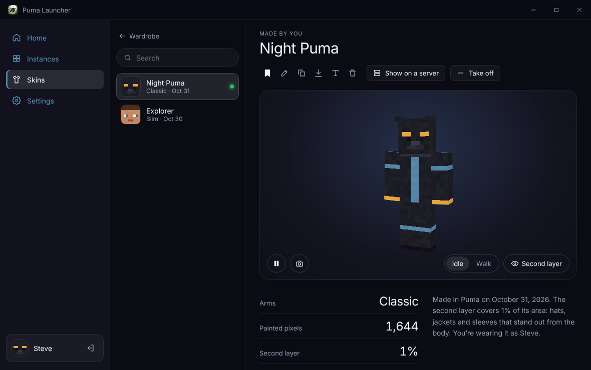 | 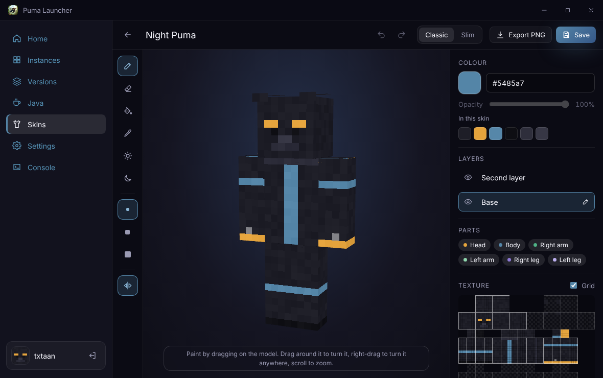 |

## Features

- Login screen: Microsoft, offline, or Ely.by / LittleSkin / custom server, plus saved accounts to switch between
- Home screen with a jungle-scene hero (moonlit or daylight, following the theme), latest release/snapshot cards and a large **Play** button
- Instances: create with any version and mod loader; edit version, loader, Java, memory, JVM args and resolution
- Mods: recommended mods when creating an instance, a Modrinth browser with dependency resolution, plus an
  installed-mod list with enable, disable and delete
- Versions browser: releases, snapshots, beta and alpha, with search and "installed" badges
- Java manager: one-click Mojang and Temurin runtimes plus the Java installations found on this PC
- Download manager: parallel downloads with SHA-1/SHA-256 checks, retries and live progress
- Skins: a wardrobe of your skins (search, filters, bookmarks), an inspect view (turnable 3D model, animations,
  screenshots, colour palette and per-part stats) and a 3D skin editor; wear a skin with one click (see
  [step 7](#7-wear-a-skin-optional))
- Game console showing the game log (log4j XML converted to readable lines), with errors highlighted
- Light and dark themes, or follow the system setting (**Settings → Appearance**); dark is the default
- English and Italian: follows your system language, or pick one in **Settings → Appearance**

## Polymarket Billboard mod

[`mods/polymarket`](mods/polymarket) is a Forge mod for Minecraft 26.3. It adds a billboard: a big screen showing
Polymarket's live **Bitcoin Up or Down – 5 minute** market, with the Up and Down probabilities, a chart that moves with
them, and a countdown to the end of each window. Players register a trader name and trade the market with gold ingots
at the real order-book prices; winners are paid in gold and ranked on a leaderboard beside the screen. See
[its README](mods/polymarket/README.md) to install and build it.

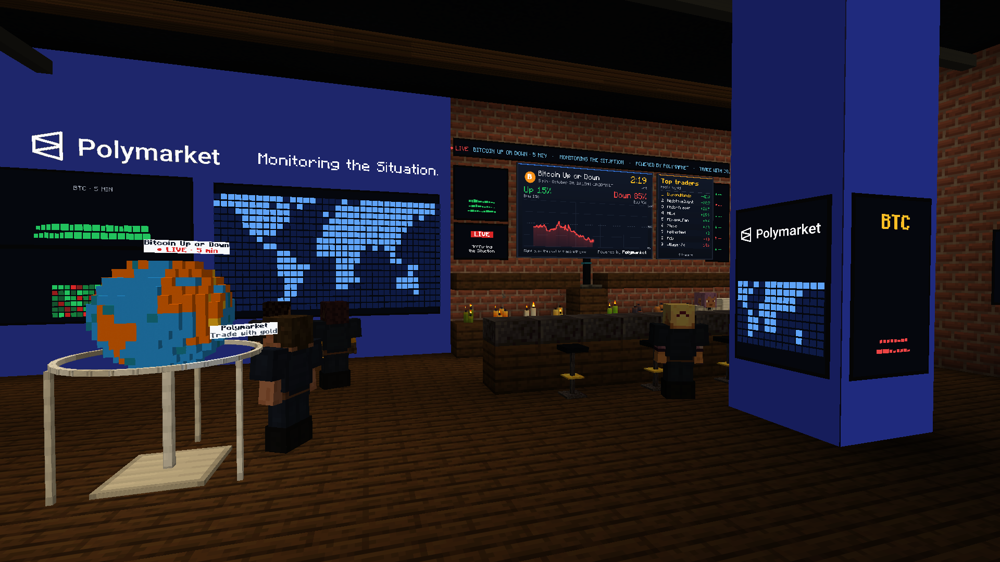

## How it works

Puma Launcher is modelled on the most active open-source launchers, checked in October 2026:

| Project | Activity in 2026 | Latest release | What we took from it |
| --- | --- | --- | --- |
| **Prism Launcher** (most active) | ~1,550 commits, 52 contributors | 11.1.1 | Instance model, mod loaders through Prism's metadata server, ForgeWrapper for modern Forge/NeoForge, Temurin Java auto-install, mod management |
| **HMCL** | ~900 commits, 37 contributors | 3.17.0 | One-click Mojang Java runtimes, authlib-injector accounts, Modrinth downloads |
| ElyPrism / Fjord / Freesm | Prism forks that track upstream | 11.1.1-based | Third-party login servers (Ely.by, custom authlib-injector servers) |

| Feature | Comes from | How it works here |
| --- | --- | --- |
| Always up-to-date versions | HMCL, Prism | Mojang's `version_manifest_v2.json`, re-checked in the background (every 10 min by default). New releases and snapshots trigger a notification. |
| Fabric, Quilt, Forge, NeoForge | Prism | Loader versions and libraries come from Prism's metadata server (`meta.prismlauncher.org`), which is updated within hours of each loader release. Components are applied over vanilla the same way Prism's `LaunchProfile` does. Modern Forge/NeoForge run through Prism's **ForgeWrapper**, which runs the official installer steps on first launch. Legacy Forge (1.12.2 and older) uses LaunchWrapper tweakers. |
| One-click Java | HMCL, Prism | Mojang's own runtimes first (Java 8/16/17/21/25), then **Eclipse Temurin** from Prism's metadata for anything Mojang doesn't ship (Linux ARM64, newer Java). You never need to install Java yourself: the right version starts downloading as soon as you create an instance (or change its version), so it is ready before you press **Play**. Java installed on your PC is only used if you pick it for an instance, turn automatic downloads off, or the download fails. |
| Use the Java already on your PC | Prism forks | Scans `JAVA_HOME`, `PATH` and the usual install folders. Each instance can be pinned to any detected Java or a custom path. |
| Mods from Modrinth | Prism, HMCL | Search mods compatible with the instance's loader and version, install them with their required dependencies (SHA-1 verified), and enable, disable or delete installed mods. |
| Isolated instances | Prism | Each instance has its own game folder, loader, Java, memory, JVM arguments and window size. |
| Accounts | HMCL, Prism, ElyPrism, Fjord | Microsoft (device code), offline, and **authlib-injector** servers (Ely.by, LittleSkin or any custom Yggdrasil server). Tokens are encrypted with the OS keychain. |

### Skins

The skin editor is Puma's own code (`src/renderer/src/skins/`), written for the launcher. Before writing it we read
the README and changelog of [MineSkin PRO](https://github.com/hamza512b/mineskin), an AGPL-3.0 web and mobile skin
editor, to see what users ask for and what went wrong there; none of its code was used.

| | MineSkin PRO (from its README and changelog) | Puma |
| --- | --- | --- |
| Where it runs | Web, iOS and Android app (Next.js, Capacitor), with Sentry and Vercel Analytics | Inside the launcher, offline, no tracking |
| Using the skin | Export the PNG and apply it in Minecraft yourself (its usage guide explains how) | **Wear** uploads it to your Microsoft profile, or adds it to the game for offline accounts |
| Rendering | Custom WebGL renderer; the changelog lists fixes for flickering and for artifacts around the skin | three.js, redrawn only when something changes; faces are sampled slightly inside their edges so they never bleed into each other |
| Export | Browser download, which failed silently in some in-app browsers until September 2026 | The system's Save dialog |
| Shortcuts | Undo and redo shortcuts on Mac fixed in October 2025 | Ctrl or ⌘ for undo, redo and save, plus one-key tools |

Puma's editor also has a mirror that follows the body (paint the right arm and the left arm gets the same, outer side
to outer side), a fill that stays inside the face you click, an arm-width switch that resamples the arms instead of
leaving gaps, the old 64×32 format upgraded the way the game does it, and an inspect view with the skin's palette and
per-part numbers. MineSkin has things Puma's editor doesn't have yet: posing limbs by hand, reference images and clip
recording.

The 3D model is built with [three.js](https://threejs.org) (MIT). Templates are drawn in code: Puma ships no Mojang
textures.

No code was copied from HMCL or Prism Launcher. The launcher uses their public metadata services and the
ForgeWrapper and authlib-injector jars at runtime. It is licensed GPL-3.0-or-later, the same licence as both projects.

### Tested

Each of these was installed and launched from a clean data folder on Linux:
vanilla 26.3 (Java 25) and 1.12.2 (Java 8), Fabric 0.20.1 on 26.3 with Fabric API from Modrinth,
NeoForge 26.3.0.99, Forge 52.1.20 on 1.21.1, and Forge 14.23.5 on 1.12.2.

The test machine has no GPU, so vanilla 26.3 was also run with Mesa's software renderer (llvmpipe/lavapipe)
on a virtual display. The game reached the title screen and loaded into a new singleplayer world:

| Title screen | In a world |
| --- | --- |
| 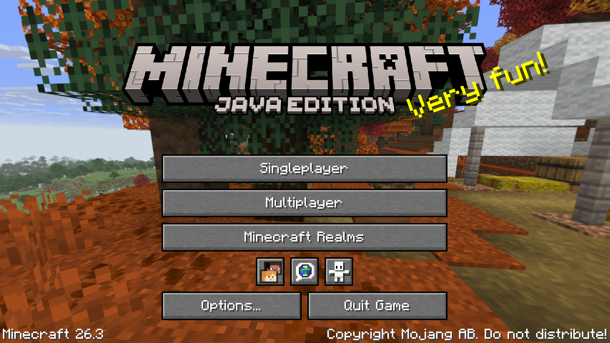 | 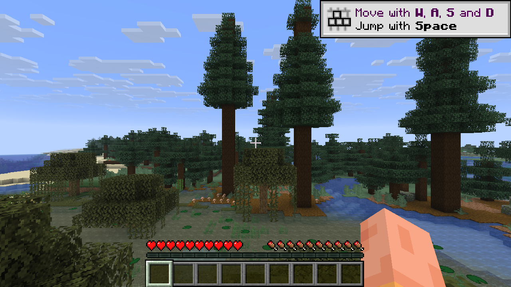 |

### Platforms

| Platform | Status |
| --- | --- |
| Windows 10/11 (x64) | Supported: Mojang Java for every version. Not tested on real hardware yet. |
| macOS Intel | Supported: Mojang Java for every version, native window buttons. Not tested on real hardware yet. |
| macOS Apple Silicon (M1–M4) | Minecraft 1.19 and newer run natively with Mojang's ARM Java (17, 21, 25). Older versions use LWJGL 2 without ARM builds and are not supported yet. |
| Linux x64 / ARM64 | Tested on x64. ARM64 gets Java from Eclipse Temurin. |

## Microsoft login setup

Microsoft requires every launcher to use its own Azure application:

1. In the [Azure portal](https://portal.azure.com) go to **App registrations → New registration**.
   Choose **Personal Microsoft accounts only**.
2. Under **Authentication**, turn on **Allow public client flows**. This enables the device-code flow.
3. Copy the **Application (client) ID** into **Settings → Accounts** in the launcher, or set the
   `PUMA_MS_CLIENT_ID` environment variable.
4. New Azure apps also need Mojang's approval before they can use the Minecraft API. Submit the
   [Minecraft API access form](https://aka.ms/mce-reviewappid). Until it is approved, sign-in stops
   at the Minecraft step with HTTP 403.

Offline mode works without any of this.

## Where your data is stored

| OS | Folder |
| --- | --- |
| Windows | `%APPDATA%\puma-launcher` |
| macOS | `~/Library/Application Support/puma-launcher` |
| Linux | `~/.config/puma-launcher` |

To use another folder, set the `PUMA_HOME` environment variable. Data from older versions (the `txtaan-launcher` folder, from before the rename) is moved to the new folder automatically on first start. The layout follows `.minecraft`
(`versions/`, `libraries/`, `assets/`), plus `runtime/` for downloaded Java, `instances/` for instances and `skins/`
for your skin library.

## Building from source

```bash
npm install
npm run dev        # start with hot reload
npm run build      # production build into out/
npm run dist       # package installers into release/ (electron-builder)
npm run typecheck
```

Requires Node.js 20 or newer.

### Publishing a release

GitHub Actions builds every installer automatically (`.github/workflows/build.yml`):

- **Any push:** open the **Actions** tab, pick the latest "Build installers" run, and download the
  `PumaLauncher-Windows`, `PumaLauncher-macOS` or `PumaLauncher-Linux` artifact at the bottom of the page.
- **A release:** bump `version` in `package.json` (it is part of the file names), then in the **Actions** tab open
  "Build installers", click **Run workflow** and enter the version, such as `v0.3.0`; or push a version tag
  (`git tag v0.3.0 && git push origin v0.3.0`). The installers are attached to a new GitHub Release, which is what
  the [Download](#1-download) link points to. If the macOS build can't start, untick **mac** to release Windows and
  Linux first; running it again for the same version with **mac** ticked adds the macOS installers to that release.
  The version must be higher than the last release's: installed launchers update to the latest release, using the
  `latest*.yml` files the workflow uploads next to the installers (`src/main/core/updater.ts`).

You can also build installers locally with `npm run dist` on each OS: `.exe` (NSIS) on Windows, `.dmg` on macOS,
AppImage/`.deb` on Linux. Without code signing, Windows SmartScreen and macOS Gatekeeper show a warning the first
time. Signing needs a code-signing certificate on Windows and an Apple Developer ID on macOS.

## Project layout

```
src/
  main/            Electron main process
    core/
      versions.ts  Mojang version manifest + background refresh
      meta.ts      Prism metadata client (mod loaders, intermediary mappings)
      mods.ts      Modrinth search/install and local mod management
      archive.ts   zip/tar extraction
      install.ts   version JSON resolution, libraries, natives, assets
      java.ts      Java detection + Mojang / Temurin runtime downloads
      launch.ts    argument building and process spawning
      auth.ts      Microsoft (device code), offline and authlib-injector accounts
      instances.ts instance storage
      http.ts      downloads with SHA-1 checks, retries and concurrency
      i18n.ts      language for main-process text (progress, errors, console lines)
      updater.ts   the launcher's own updates from GitHub Releases
      skins.ts     skin library, Mojang skin upload, and the resource pack for offline accounts
  preload/         typed, sandboxed IPC bridge (window.launcher)
  renderer/        React UI
    src/styles/theme.css  all colours, gradients and radii for the dark and light themes (edit this file to re-theme)
    src/styles/app.css    layout and components
    src/pages/            Login, Home, Instances, Versions, Java, Skins, Settings
    src/skins/            the 3D player model (three.js), skin layout maths, the editor, and the Skins screens
  shared/types.ts  types shared by all three layers
  shared/i18n/     English (en.ts, the source of every message) and Italian (it.ts) text
```

### Browser preview (for UI work)

`npm run preview:web` runs the real React UI in a normal browser, with live reload, against a stand-in backend
(`preview/mock-launcher.ts`) and a snapshot of real Mojang/Prism/Modrinth data (`preview/sample-data.json`).
Downloads and launches are simulated, so you can click through every screen without Electron or Minecraft.
`npm run build:preview` produces a single shareable file, `out/preview/index.html`.

### Changing the UI

The UI only talks to the launcher through `window.launcher` (see `src/preload/index.ts`), so the
renderer can be redesigned or replaced freely. To change the look, start with the tokens in
`src/renderer/src/styles/theme.css`, for example `--accent` and `--brand-gradient` for buttons and highlights, and
`--cover-gradient` for the instance covers. The jungle scenes on the welcome and home screens are images in
`src/renderer/src/assets`; the home hero shows the night art in the dark theme and the day art in the light one.
`:root` holds the dark theme and `:root[data-theme='light']` overrides its colours for the light theme, so a new
colour token needs a value in both.

### Adding or changing text

All text lives in `src/shared/i18n`. Add the English message to `en.ts`, then the same key to `it.ts`: the
typecheck fails until every language has it. In the UI use `t('key')` from `useStore()`; in the main process
use `tr('key')`. `{name}` placeholders are filled from the second argument.

## License

GPL-3.0-or-later. See [LICENSE](LICENSE).

NOT AN OFFICIAL MINECRAFT PRODUCT. NOT APPROVED BY OR ASSOCIATED WITH MOJANG OR MICROSOFT. Minecraft is a
trademark of Mojang AB.

## Security

To report a security problem, see [SECURITY.md](SECURITY.md). Please don't open a public issue for it.
