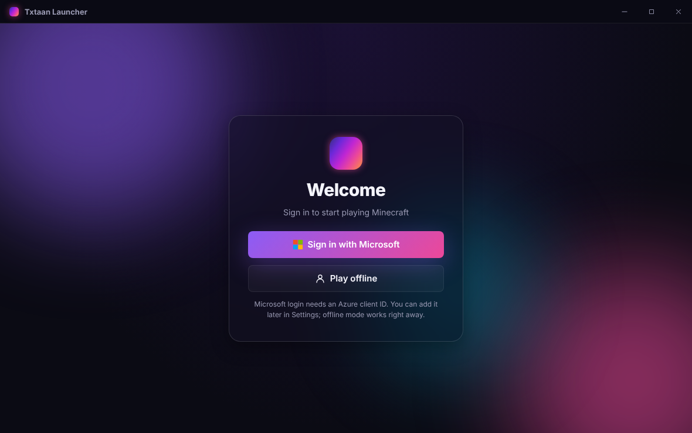

# Txtaan Launcher

A modern, open-source Minecraft: Java Edition launcher built with Electron, React and TypeScript.
It borrows the best ideas from two popular open-source launchers:


| Idea | Inspired by | How it works here |
| --- | --- | --- |
| Always up-to-date version list (every release and snapshot) | HMCL, Prism Launcher | Reads Mojang's official `version_manifest_v2.json` and re-checks it in the background (every 10 min by default). New versions show up with a notification, no restart needed. |
| One-click Java download (e.g. Java 21/25 for recent versions) | HMCL | Uses Mojang's own Java runtime index, the same one the official launcher uses. When you press **Play**, the exact Java version the game needs is downloaded automatically. You can also download runtimes yourself from the **Java** page. |
| Use the Java already installed on your PC | Prism Launcher forks | Scans `JAVA_HOME`, `PATH` and the usual install folders (Adoptium, Zulu, Microsoft, Corretto, `/usr/lib/jvm`, macOS JavaVirtualMachines, SDKMAN, `~/.jdks`). Each instance can be pinned to any detected Java or to a custom path. |
| Isolated instances | Prism Launcher | Every instance has its own game folder (worlds, mods, resource packs, options), memory, JVM arguments and window size. |
| Microsoft and offline accounts | HMCL, Prism Launcher | Microsoft sign-in with the device-code flow (Xbox Live → XSTS → Minecraft services). Offline accounts use the same UUID derivation as vanilla servers. Tokens are stored encrypted with the OS keychain via Electron `safeStorage`. |

No code was copied from HMCL or Prism Launcher. This project re-implements the same publicly documented
Mojang formats. It is licensed under GPL-3.0-or-later, like both of them.

## Features

- Login screen with Microsoft and offline sign-in, plus saved accounts to switch between
- Home screen with an animated gradient hero, latest release/snapshot cards and a large **Play** button
- Instances: create, edit (version, Java, memory, JVM args, resolution), open folder, delete
- Versions browser: releases, snapshots, beta and alpha, with search and "installed" badges
- Java manager: one-click Mojang runtimes plus a list of the Java installations on this PC
- Download manager: parallel downloads with SHA-1 checks, retries and live progress
- Game console showing the game log, with warnings and errors highlighted
- Handles modern (`arguments`) and legacy (`minecraftArguments`) version formats, legacy LWJGL 2 natives,
  pre-1.7 virtual assets, log4j configs and `inheritsFrom` profiles (Fabric/Quilt/Forge JSONs placed in `versions/`)

| Login | Java manager |
| --- | --- |
|  |  |

## Getting started

```bash
npm install
npm run dev        # start with hot reload
npm run build      # production build into out/
npm run dist       # package installers into release/ (electron-builder)
npm run typecheck
```

Requires Node.js 20 or newer.

### Where data is stored

| OS | Folder |
| --- | --- |
| Windows | `%APPDATA%\txtaan-launcher` |
| macOS | `~/Library/Application Support/txtaan-launcher` |
| Linux | `~/.config/txtaan-launcher` |

To use another folder, set the `TXTAAN_HOME` environment variable. The layout follows `.minecraft`
(`versions/`, `libraries/`, `assets/`), plus `runtime/` for downloaded Java and `instances/` for instances.

### Microsoft login setup

Microsoft requires every launcher to use its own Azure application:

1. In the [Azure portal](https://portal.azure.com) go to **App registrations → New registration**.
   Choose **Personal Microsoft accounts only**.
2. Under **Authentication**, turn on **Allow public client flows**. This enables the device-code flow.
3. Copy the **Application (client) ID** into **Settings → Accounts** in the launcher, or set the
   `TXTAAN_MS_CLIENT_ID` environment variable.
4. New Azure apps also need Mojang's approval before they can use the Minecraft API. Submit the
   [Minecraft API access form](https://aka.ms/mce-reviewappid). Until it is approved, sign-in stops
   at the Minecraft step with HTTP 403.

Offline mode works without any of this.

## Project layout

```
src/
  main/            Electron main process
    core/
      versions.ts  Mojang version manifest + background refresh
      install.ts   version JSON resolution, libraries, natives, assets
      java.ts      Java detection + Mojang runtime downloads
      launch.ts    argument building and process spawning
      auth.ts      Microsoft (device code) and offline accounts
      instances.ts instance storage
      http.ts      downloads with SHA-1 checks, retries and concurrency
  preload/         typed, sandboxed IPC bridge (window.launcher)
  renderer/        React UI
    src/styles/theme.css  all colours, gradients and radii (edit this file to re-theme)
    src/styles/app.css    layout and components
    src/pages/            Login, Home, Instances, Versions, Java, Settings
  shared/types.ts  types shared by all three layers
```

### Changing the UI

The UI only talks to the launcher through `window.launcher` (see `src/preload/index.ts`), so the
renderer can be redesigned or replaced freely. To change the look, start with the tokens in
`src/renderer/src/styles/theme.css`, for example `--hero-gradient` for the home screen gradient
and `--brand-gradient` for buttons.

## License

GPL-3.0-or-later. See [LICENSE](LICENSE). Minecraft is a trademark of Mojang AB; this project is
not affiliated with Mojang or Microsoft.
