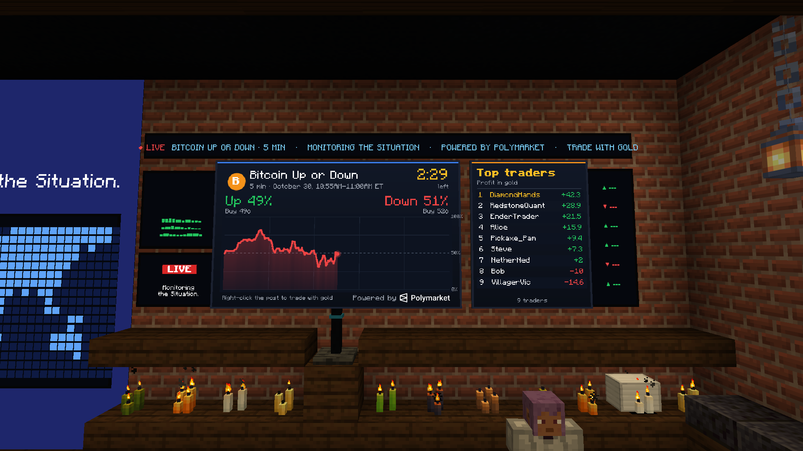
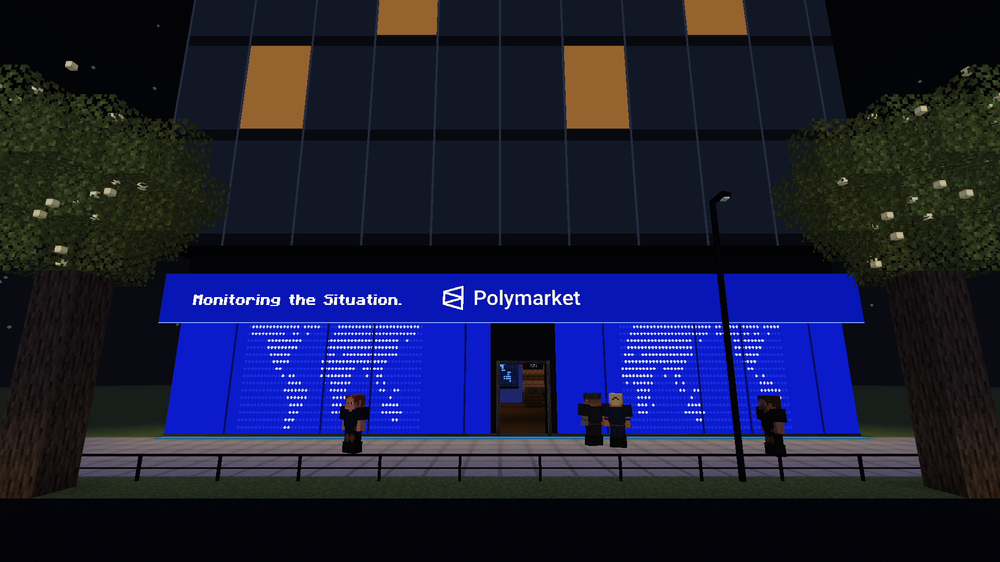

# Polymarket Prediction Market (Forge mod for Minecraft 26.3)

A big screen in your world that shows Polymarket's live **Bitcoin Up or Down – 5 minute** market. Players trade it
with gold ingots and compete on a leaderboard beside the screen.


- **Live market:** the screen follows the current five-minute window, from Polymarket's
  [`btc-up-or-down-5m`](https://polymarket.com/crypto/5M) series. A new market starts every five minutes.
- **What the screen shows:**
  - the Up and Down probabilities;
  - the prices to buy each side;
  - a countdown to the end of the window;
  - a chart of the Up probability that moves with the market, once a second.
- **Leaderboard:** a panel beside the screen lists the top traders of the world by profit, in gold.
- **Gold trading:** right-click the billboard's post to trade.
  - The first time, you pick a trader name. It's the name on the leaderboard.
  - You stake gold ingots from your inventory on Up or Down. Orders fill at the real Polymarket order book: they take
    the best asks, level by level, like a market order.
  - You can sell before the window ends, at the real bids.
  - When Polymarket resolves the market, a minute or two after the window ends, each winning share pays 1 gold and
    losing shares are worth nothing. Everyone sees it in chat: "Alice has won 25.4 gold on Bitcoin Up or Down –
    October 30, 8:20AM-8:25AM ET".
- **No real money:** no Polymarket account, no keys, no wallet. The mod only reads Polymarket's public data, and the
  gold is Minecraft gold.




## Install

**With Puma Launcher:**

1. Create an instance **With mods**, with **Minecraft 26.3** and **Forge** (66.1 or newer). Among the recommended
   mods, tick **Polymarket Prediction Market**.
2. Or, for an instance you already have: **Instances** → **Mods** on the instance → **Browse mods** → **Polymarket
   Prediction Market** → **Install**.
3. Start the game.

The launcher downloads the jar from its GitHub release and checks it against the SHA-256 checksum GitHub publishes.

**By hand:** download `polymarket-prediction-market-<version>.jar` from the
[latest release](https://github.com/txtaan/Puma-Launcher-Minecraft/releases/latest) and put it in the `mods` folder of a
Forge 26.3 instance.

### On a server

Install the mod on the server and on every player's game. Trades, payouts and the leaderboard are handled by the
server, so all the players of a world share one leaderboard. The server needs internet access, to read Polymarket's
public API.

- **A server where you can upload files** (your own, or hosts such as exaroton): put the jar in the server's `mods`
  folder. In Puma Launcher, **Browse mods** → **Server .jar** saves it for you.
- **Aternos** only installs mods from CurseForge and Modrinth. Once the mod is
  [on Modrinth](https://modrinth.com/mod/polymarket-prediction-market): set the server to Forge for Minecraft 26.3,
  then **Mods** → search **Polymarket Prediction Market** → **Install**.

#### Publishing on Modrinth

The [Publish the mod on Modrinth](../../.github/workflows/modrinth.yml) workflow does it, and runs after every
release. The first time, it creates the Modrinth project (with [modrinth.md](modrinth.md) as its description, the
icon and the screenshots) and submits it for Modrinth's review: Aternos lists the mod once Modrinth approves it.
It needs one setting:

1. On Modrinth, signed in: [modrinth.com/settings/pats](https://modrinth.com/settings/pats) → **Create a PAT**. Give it
   a name and an expiry date far ahead, and tick the **Create projects**, **Read projects**, **Write projects**,
   **Create versions** and **Read versions** scopes. Copy the token it shows.
2. On GitHub: the repository's **Settings** → **Secrets and variables** → **Actions** → **New repository secret**,
   named `MODRINTH_TOKEN`, with the token as its value.
3. To publish a release that's already out: **Actions** → **Publish the mod on Modrinth** → **Run workflow**.

To change the Modrinth page, edit [modrinth.md](modrinth.md): the workflow copies it to Modrinth on every run.

## Use

- **Get one:** the **Polymarket Prediction Market** block is in the **Functional Blocks** creative tab. In survival
  you can craft it from three glass panes on top, then a glass pane, redstone and a glass pane, and an iron ingot at
  the bottom centre.
- **Place it:** the screen (5 blocks wide, 3 tall) and the leaderboard beside it appear above the post, facing you, so
  leave room above and to the right.
- **Register:** right-click the post and pick a name: 3 to 16 letters, numbers or `_`, not already taken in the world.
- **Trade** (Trade tab):
  - the same chart, with the prices to buy and sell each side;
  - how many gold ingots to stake (1, 5, 16, 64, or type a number up to 640);
  - **Buy Up / Buy Down** at the current best price. The ingots are taken from your inventory; any part of the stake the
    order book can't fill is given back.
  - You must stand within 10 blocks of a billboard. Buying stops 3 seconds before the window ends.
- **Your profile** (Profile tab):
  - your rank, profit, wins and losses;
  - your open positions with what they're worth now, and **Sell**;
  - your last trades.

  

- **Leaderboard** (Leaderboard tab): every trader, ranked by profit (realised, in gold), with their trades and wins.

### Getting paid

- **Gold:** a winning share pays 1 gold. Ingots are paid whole and the rest in gold nuggets (9 nuggets = 1 ingot);
  any fraction of a nugget is dropped. Selling pays the same way.
- **Where it goes:**
  1. Into your inventory: first onto the gold you already carry, then into free slots.
  2. If your inventory is full, into a chest behind the billboard where you bought. The mod places the chest if that
     spot is free.
  3. If you're offline, or there's no room in the chest either (it's full, or another block is in the way), the gold
     waits. You get it the next time you join the world (into your inventory) or open a billboard (into your
     inventory, then the chest behind that billboard).

  

- **Saved data:** traders, positions and results are saved in the world folder, in
  `polymarket_billboard/traders.json`.

## How it works

- **Finding the market:** the current window starts at the last multiple of five minutes (Unix time). Its market is
  `btc-updown-5m-<start>` on Polymarket's Gamma API.
- **Prices:** both order books (Up and Down tokens) come from the public CLOB API (`/book`) once a second. The
  probability shown is the midpoint of the best bid and ask, or the last trade when the spread is over 10¢, the same
  rule polymarket.com uses.
- **Chart:** it starts from `/prices-history` and is then extended with each new price.
- **Trades:** the server fetches a fresh order book for every buy and sell, and fills against it.
- **Settling:** every 10 seconds, the server checks the ended markets that still have open positions. Once Polymarket
  has closed one, it pays the winners and updates the leaderboard for everyone.
- **When nothing shows the market:** the game stops polling 15 seconds after the last billboard leaves the screen or
  the trading screen closes.

Code layout:

```
src/main/java/dev/puma/polymarket/
  PolymarketBillboard.java   mod entry point: block, item, block entity, server events
  block/                     the post (BillboardBlock) and its block entity
  market/                    Polymarket data (MarketFeed), order books, fills
  trading/                   traders and their positions (TraderStore), buying, selling and payouts (Trading)
  network/                   messages between the game and the server
  client/                    the screen renderer, its textures, the trading screen
```

## Build

You need Java 25. The Gradle wrapper downloads Gradle 9.7.1, and ForgeGradle downloads Minecraft and Forge on the
first build.

```bash
cd mods/polymarket
./gradlew build          # the jar is in build/libs/
./gradlew runClient      # starts Minecraft with the mod
```

## Screenshots

The screenshots were taken in a test world, with a situation room built around a billboard and a few demo traders on
the leaderboard. The market data on the billboards is live.



## Notes

Market data comes from Polymarket's public API. This is a game, not financial advice. It is not an official
Polymarket product.

The Polymarket name and logo belong to Polymarket. The logo image in
`src/main/resources/assets/polymarket_billboard/textures/logo/` is not covered by this repository's license.
