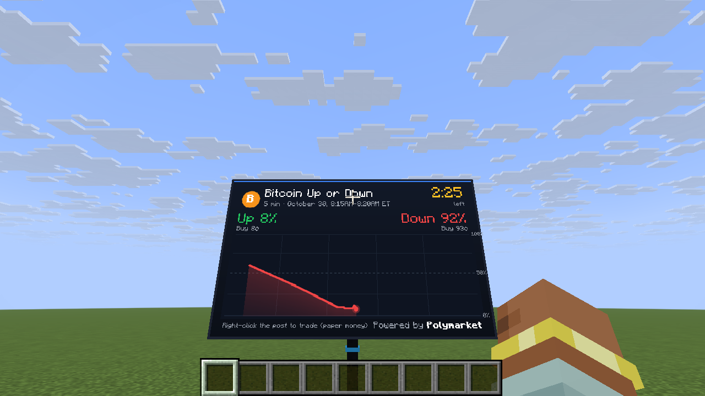
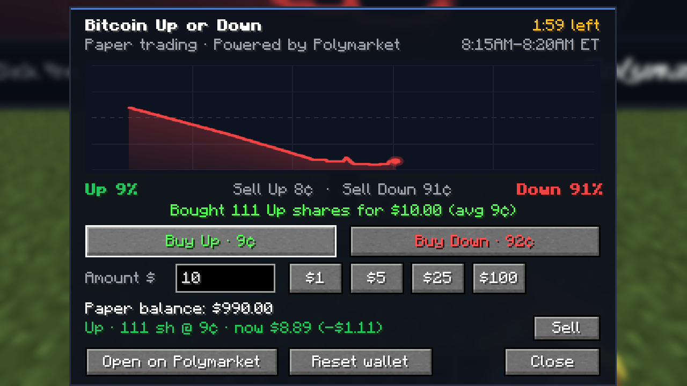

# Polymarket Billboard (Forge mod for Minecraft 26.3)

A big screen in your world that shows Polymarket's live **Bitcoin Up or Down – 5 minute** market, with paper trading
right inside Minecraft.



- **Live market:** the screen follows the current five-minute window, from Polymarket's
  [`btc-up-or-down-5m`](https://polymarket.com/crypto/5M) series. A new market starts every five minutes.
- **What the screen shows:**
  - the Up and Down probabilities;
  - the prices to buy each side;
  - a countdown to the end of the window;
  - a chart of the Up probability that moves with the market, once a second.
- **Paper trading:** right-click the billboard's post to trade.
  - You start with $1,000 of virtual money.
  - Buy Up or Down for any amount. Orders fill at the real Polymarket order book: they take the best asks, level by
    level, like a market order.
  - You can sell before the window ends, at the real bids.
  - When Polymarket resolves the market, a minute or two after the window ends, each winning share pays $1 and losing
    shares are worth nothing.
- **No real money:** no Polymarket account, no keys, no wallet. The mod only reads Polymarket's public data.



## Install

1. In [Puma Launcher](../../README.md) (or any launcher), create an instance with **Minecraft 26.3** and **Forge**
   (66.1 or newer).
2. Download `polymarket-billboard-<version>.jar`: in the repository's **Actions** tab, open the latest
   "Build Polymarket mod" run and download the `polymarket-billboard` artifact.
3. Put the jar in the instance's `mods` folder. In Puma Launcher: **Instances** → the puzzle icon → **Mods folder**.
4. Start the game.

On a server, the mod must be installed on the server and on every player's game. Each player trades with their own
paper wallet, from their own game.

## Use

- **Get a billboard:** it's in the **Functional Blocks** creative tab. In survival you can craft it from three glass
  panes on top, then a glass pane, redstone and a glass pane, and an iron ingot at the bottom centre.
- **Place it:** the screen (5 blocks wide, 3 tall) appears above the post, facing you, so leave room above.
- **Trade:** right-click the post. The trading screen has:
  - the same chart;
  - **Buy Up / Buy Down** at the current best price;
  - the amount ($1, $5, $25, $100, or type one);
  - your balance;
  - your open positions, with **Sell**;
  - your latest result.
- **Your wallet:** it's saved in `config/polymarket_billboard-paper-wallet.json` in the game folder. **Reset wallet**
  starts again from $1,000.

## How it works

- **Finding the market:** the current window starts at the last multiple of five minutes (Unix time). Its market is
  `btc-updown-5m-<start>` on Polymarket's Gamma API.
- **Prices:** both order books (Up and Down tokens) come from the public CLOB API (`/book`) once a second. The
  probability shown is the midpoint of the best bid and ask, or the last trade when the spread is over 10¢, the same
  rule polymarket.com uses.
- **Chart:** it starts from `/prices-history` and is then extended with each new price.
- **Settling:** when a window ends, the mod checks the market on Gamma until it is closed, and pays out paper positions
  from its final prices.
- **When nothing shows the market:** the mod stops polling 15 seconds after the last billboard leaves the screen or the
  trading screen closes. It still checks for resolutions every 10 seconds while you hold positions.

Code layout:

```
src/main/java/dev/puma/polymarket/
  PolymarketBillboard.java   mod entry point: block, item, block entity
  block/                     the post (BillboardBlock) and its block entity
  market/                    Polymarket data (MarketFeed), order books, paper wallet
  client/                    the screen renderer, its texture with the chart, the trading screen
```

## Build

You need Java 25. The Gradle wrapper downloads Gradle 9.7.1, and ForgeGradle downloads Minecraft and Forge on the
first build.

```bash
cd mods/polymarket
./gradlew build          # the jar is in build/libs/
./gradlew runClient      # starts Minecraft with the mod
```

Market data comes from Polymarket's public API. This is a paper-trading toy, not financial advice. It is not an official
Polymarket product.
